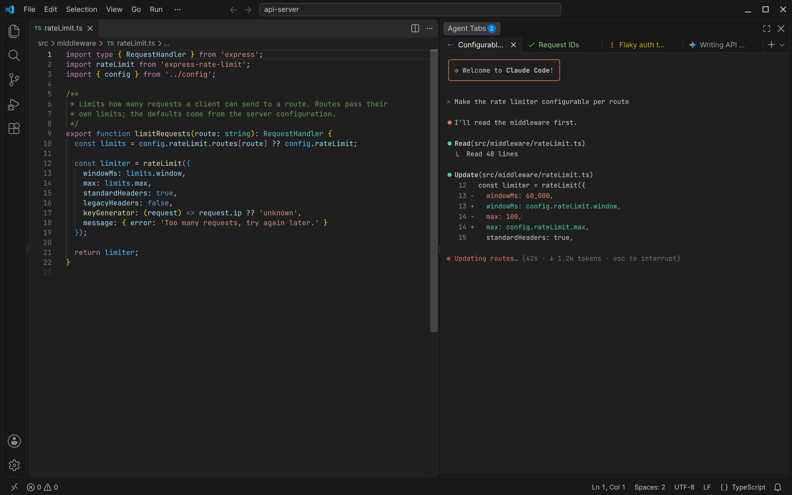
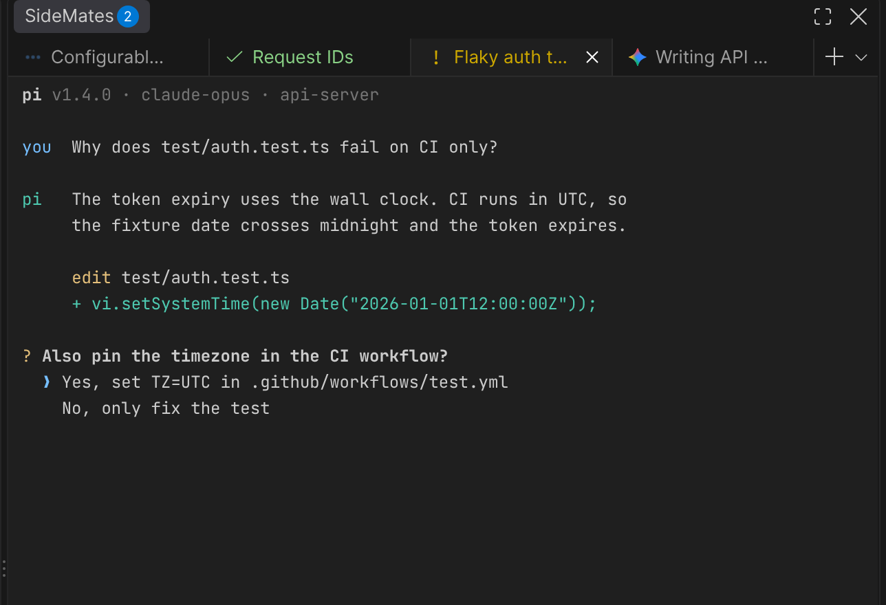
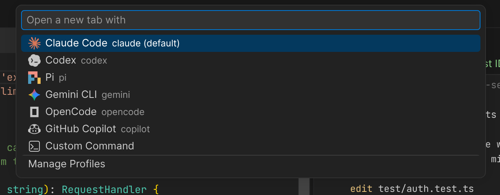

# Agent Tabs

**Your coding agents, side by side with your code.**

Agent Tabs runs Claude Code, Codex, Gemini CLI, pi and other CLI coding agents in tabs in VS Code's secondary sidebar. Keep the editor in front of you, start a few agents on different tasks, and see at a glance which one is working, which one has a question, and which one is done.



## Features

### See what every agent is doing

Each tab shows its agent's status: working, needs input, done or failed. A result that comes in while you're in another tab stays marked until you look at it, and the view's badge counts the tabs waiting for you. Agents report their status themselves through the [Program Status Protocol](https://www.superlogical.com/rex/docs/build/program-status); for the others, Agent Tabs recognizes their prompts. A pi tab also stays working while subagents of [pi-subagents](https://github.com/nicobailon/pi-subagents) run in the background after pi's own turn ended, see [Subagents](#subagents).



### Tabs that name themselves

Tabs take their name from the agent's session: Claude Code's conversation summary, a pi session name or a Codex thread, shortened to a few words. No more five tabs called `claude`.

### Every agent, one place

Open any agent from the `+ ⌄` menu, with its logo. Agent Tabs finds the agents you have installed and makes a profile for each. Profiles are plain command lines, so `claude --continue` or `env MODEL=fast pi` work, and a **Terminal** profile after them opens VS Code's default shell. **Custom Command…** runs anything else with completion for its flags. Once you have your own profiles, **Discover Profiles** in the `⌄` menu or the Command Palette adds the agents you installed since.



### Agents that keep running

With `agentTabs.multiplexer` set to `tmux` or `abduco`, each tab runs its agent in its own session. The agent keeps working when you close the window or your laptop loses the connection to a remote, and the next window shows the same tabs again, with their status. Closing a tab ends its session.

### Tabs that come back

Close VS Code with a few agents open, and the next window of the workspace opens the same tabs again, in their order and with the same one active, like editor tabs. Claude Code, pi and Cursor continue their conversation; other agents start again in their folder. Turn it off with `agentTabs.restoreTabs`.

### Reopen closed tabs

Closed a tab by accident? `Cmd+Shift+T` opens it again and continues its conversation, for Claude Code, pi and Cursor; press it again for the tab closed before. Agent Tabs gives each conversation an ID when the tab starts and remembers the last ten closed tabs of a workspace once a message was sent.

### Split the view

Drag a tab onto a terminal to open it in a new pane beside it, each with its own tabs: near the left or right edge for a pane side by side, else on the top or bottom half for one above or below. Panes split again the same way, in either direction. Drag a tab onto another pane's tab strip to move it there, and the edge between two panes to resize them. `Cmd+\` (`Ctrl+Shift+5` on Windows and Linux) opens a new tab in a pane below, like Split Terminal, and Split Terminal Right in a pane to the right. New tabs and the tab keys act on the pane you clicked into last. The next window opens the panes again with their tabs and sizes.

### Works like VS Code

Tabs use the keys you know from editors and can be dragged into another order, clicking `src/app.ts:42` in an agent's output opens it in the editor, and the terminal takes VS Code's theme and font. Closing a tab whose agent is still working asks first. When an agent exits, Enter starts it again in the same tab.

## Supported agents

| Agent | Command | Status | Tab name from |
| --- | --- | --- | --- |
| Claude Code | `claude` | Reported (2.1.295+) | Conversation summary |
| Codex | `codex` | Reported (0.163+) | Thread name |
| pi | `pi` | Reported (1.1+) | Session name (`/name`) |
| OpenCode | `opencode` | Reported | Session title |
| Grok Build | `grok` | Reported (1.0.52+) | — |
| Devin | `devin` | Reported | — |
| Hermes Agent | `hermes` | Reported | Session title |
| Gemini CLI | `gemini` | From prompts | Current thought |
| GitHub Copilot | `copilot` | From prompts | — |
| Cursor | `agent` | From prompts | — |
| Antigravity | `agy` | From prompts | Your title script |

An agent is recognized as the program a profile's command line runs, also behind a wrapper: `env`, `nohup`, `npx`/`bunx`/`pnpm dlx` (by command or package name), `tmux new-session`, `abduco`, `ssh <host>` or `bash -c`. An agent that runs on another machine (`ssh`) or from a package (`npx`) is not looked for on the local PATH. The extension adds no arguments when a subcommand such as `claude doctor` follows the agent. Any other program runs too, with prompt-based status: a shell gets the terminal icon, anything else a sparkle. A profile's `kind` overrides the icon, e.g. `"kind": "claude"` for a script that starts Claude, or `"sparkle"`; `null` is the same as leaving it out. To run agents in tmux, use `agentTabs.multiplexer` instead of `tmux` in the command line, which hides their status.

## Keyboard shortcuts

The same keys as VS Code's editor tabs, active while Agent Tabs has focus. On Windows and Linux, closing is `Ctrl+Shift+W`, because `Ctrl+W` deletes a word in the agents.

| Action | macOS | Windows / Linux |
| --- | --- | --- |
| New tab | `Cmd+N` | `Ctrl+N` |
| Close tab | `Cmd+W` | `Ctrl+Shift+W`, `Ctrl+F4` (Windows) |
| Reopen closed tab | `Cmd+Shift+T` | `Ctrl+Shift+T` |
| Next / previous tab | `Cmd+Alt+→` / `Cmd+Alt+←`, `Cmd+Shift+]` / `Cmd+Shift+[` | `Ctrl+PageDown` / `Ctrl+PageUp` |
| Go to tab 1–9 / last tab | `Ctrl+1` … `Ctrl+9` / `Ctrl+0`, `Cmd+9` | `Alt+1` … `Alt+9` / `Alt+0` |
| Recently used tabs | `Ctrl+Tab` / `Ctrl+Shift+Tab` | `Ctrl+Tab` / `Ctrl+Shift+Tab` |
| Move tab left / right | `Cmd+K` `Cmd+Shift+←` / `Cmd+K` `Cmd+Shift+→` | `Ctrl+Shift+PageUp` / `Ctrl+Shift+PageDown` |
| Split into a new pane below | `Cmd+\`, `Ctrl+Shift+5` | `Ctrl+Shift+5` |
| Split into a new pane to the right | `Cmd+K` `Cmd+\` | — |
| Focus previous / next pane | `Cmd+Alt+↑` / `Cmd+Alt+↓` | `Alt+↑` / `Alt+↓` |

Move Tab to Start and Move Tab to End have no key, as in VS Code; bind one in Keyboard Shortcuts if you like. With several panes, the tab keys, Close Others and the tab positions act on the focused pane, and the pane keys follow VS Code's split terminal; they only apply while the view is split.

Line editing follows VS Code too: `Cmd+←/→` jumps to the start or end of the line, `Cmd+Backspace` and `Option+Backspace` delete to the line start or the previous word, and `Shift+Enter` inserts a new line in agents that support it.

## Settings

**Profiles and tabs**

| Setting | Default | Description |
| --- | --- | --- |
| `agentTabs.profiles` | installed agents | Profiles in menu order, each with a unique `name`, a `command` line and optionally `env` and `multiplexer`. In a remote window, profiles come from the remote's settings. |
| `agentTabs.defaultProfile` | first profile | The `name` of the profile `+` opens, e.g. `Claude Code`. |
| `agentTabs.multiplexer` | `none` | Run tabs in `tmux` (3.2+) or `abduco` sessions that outlive the window. |
| `agentTabs.onExit` | `auto` | When an agent exits: `auto` closes the tab after a clean exit and keeps it after an error, or `close`, `restart`, `keep`. |
| `agentTabs.restoreTabs` | `true` | Open the tabs of the last window again, continuing the conversations of Claude Code, pi and Cursor. |
| `agentTabs.confirmClose` | `true` | Ask before closing a tab whose agent is working or waiting for input, or whose detached session still runs. |

**Tab names and icons**

| Setting | Default | Description |
| --- | --- | --- |
| `agentTabs.autoTabTitles` | `true` | Name tabs after the agent's session, or the first message until the agent names it, instead of the profile. |
| `agentTabs.tabTitleWords` | `4` | Words in a tab name (1–12); filler words are dropped. |
| `agentTabs.transformTabTitles` | `true` | Write tab names from your first message and Claude Code's generated session names in sentence case: `fix-login-bug` becomes `Fix login bug`. |
| `agentTabs.monochromeIcons` | `false` | Agent logos in the text color instead of brand colors. |

**Status**

| Setting | Default | Description |
| --- | --- | --- |
| `agentTabs.programStatus` | `true` | Show the status agents report. |
| `agentTabs.statusColors` | `true` | Color status icons and the names of tabs that need you. |
| `agentTabs.promptNotification` | `true` | Mark background tabs whose program shows a prompt, for agents that report no status. |
| `agentTabs.promptNotificationDelay` | `300` | Milliseconds output must be quiet before a prompt counts. |
| `agentTabs.promptPatterns` | `[]` | More regular expressions that match a prompt. |

**Process**

| Setting | Default | Description |
| --- | --- | --- |
| `agentTabs.directMode` | `true` | Start the command directly. Turn off to run it in a shell, for aliases or shell syntax. |
| `agentTabs.shell` | system shell | Shell to use when `directMode` is off. |
| `agentTabs.autoRun` | `true` | With `directMode` off, run the profile's command when the shell starts. |
| `agentTabs.env` | `{}` | Environment variables for every tab. |

## Installation

Install **Agent Tabs** from the [Visual Studio Marketplace](https://marketplace.visualstudio.com/items?itemName=patrick-lindemann.agent-tabs), or run:

```bash
code --install-extension patrick-lindemann.agent-tabs
```

Agent Tabs opens in the secondary sidebar. You need VS Code 1.106 or later and at least one agent on your `PATH`.

For offline or remote machines, download the `.vsix` for your platform from the [latest release](https://github.com/patrick-lindemann/agent-tabs/releases/latest) and use **Extensions: Install from VSIX…**, or run the installer:

```bash
curl -fsSL https://raw.githubusercontent.com/patrick-lindemann/agent-tabs/main/install.sh | sh
```

## Troubleshooting

- **An agent shows as not installed:** VS Code does not see it on its `PATH`. Start VS Code from a shell where the command works, or add its folder through `agentTabs.env`.
- **An agent needs shell aliases or functions:** turn off `agentTabs.directMode`.
- **The terminal stays blank after a VS Code update:** update Agent Tabs; its terminal module must match VS Code's version.

## Subagents

[pi-subagents](https://github.com/nicobailon/pi-subagents) runs subagents in the background: pi starts them, its turn ends, and the subagents' results start a new turn later. pi itself reports **done** when its turn ends. pi-subagents (0.77+) reports each background run on its own, as a child record of the Program Status Protocol (`id=subagents/<run>`, `app=pi-subagents`), and Agent Tabs combines them with pi's status:

| pi | A background run | Tab |
| --- | --- | --- |
| Working or done | Working | Working |
| Any | Waiting for an answer | Needs input |
| Done | None left working | Done |

A run counts until pi-subagents reports it finished, failed, stopped or cleared. Closing a tab with running subagents asks first. The status shows with tmux too, which Agent Tabs reads it from; it needs nothing to set up. pi-subagents' `programStatus: false` setting, or `PI_PROGRAM_STATUS=0`, turns its reports off, and the tab shows only pi's own status again.

Agent Tabs ignores child records of other agents. Claude Code reports its background shells as child records, and a dev server would keep the tab working for as long as it runs.

## Sessions that outlive the window

Set `agentTabs.multiplexer` in the settings of the machine the agents run on, e.g. in the remote's user settings, so they keep running while you are disconnected:

```json
"agentTabs.multiplexer": "tmux",
"agentTabs.profiles": [
  { "name": "Claude Code", "command": "claude" },
  { "name": "Shell", "command": "bash", "multiplexer": "none" }
]
```

- **tmux** (3.2 or later): sessions run on their own server, `tmux -L agent-tabs`, apart from yours; your `~/.tmux.conf` applies. tmux keeps the agents' status reports to itself, so Agent Tabs reads them from a control client. The output scrolls in tmux's history, with the mouse wheel; `prefix d` detaches the tab, Enter attaches it again.
- **abduco**: passes everything through, so the tab's scrollback and status work as without a multiplexer. Agents with a full-screen interface redraw when the tab attaches again.

Closing a tab ends its session. Closing the window, reloading it or losing the connection keeps the sessions, and the next window of the same workspace attaches to them, also from another computer. VS Code also keeps a remote's processes for a while after a connection drops; a multiplexer keeps them until you close their tabs. A status that changed while no window was attached shows once the agent reports again.

Agent Tabs tags the sessions it starts with their workspace and profile, on the machine they run on, and only ever lists, attaches to or ends tagged sessions. When a window opens, sessions of other workspaces whose agent has exited are ended; running agents of a workspace keep running until you open it again and close their tabs.

## Contributing

Issues and pull requests are welcome on [GitHub](https://github.com/patrick-lindemann/agent-tabs). See [CONTRIBUTING.md](CONTRIBUTING.md) for development and testing.

## Acknowledgements

Agent Tabs started as a fork of [Nolikzero/claude-terminal-panel](https://github.com/Nolikzero/claude-terminal-panel). It uses [xterm.js](https://xtermjs.org/), [node-pty](https://github.com/microsoft/node-pty), [stopword](https://github.com/fergiemcdowall/stopword), VS Code Codicons and Lobe Icons; see [THIRD_PARTY.md](THIRD_PARTY.md).

## License

[MIT](LICENSE.md)
