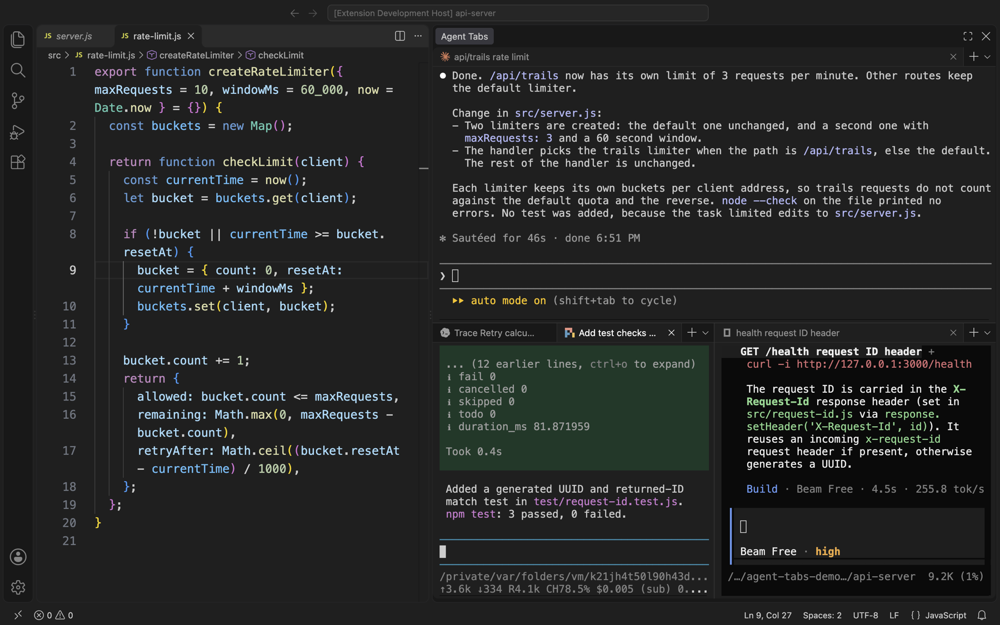
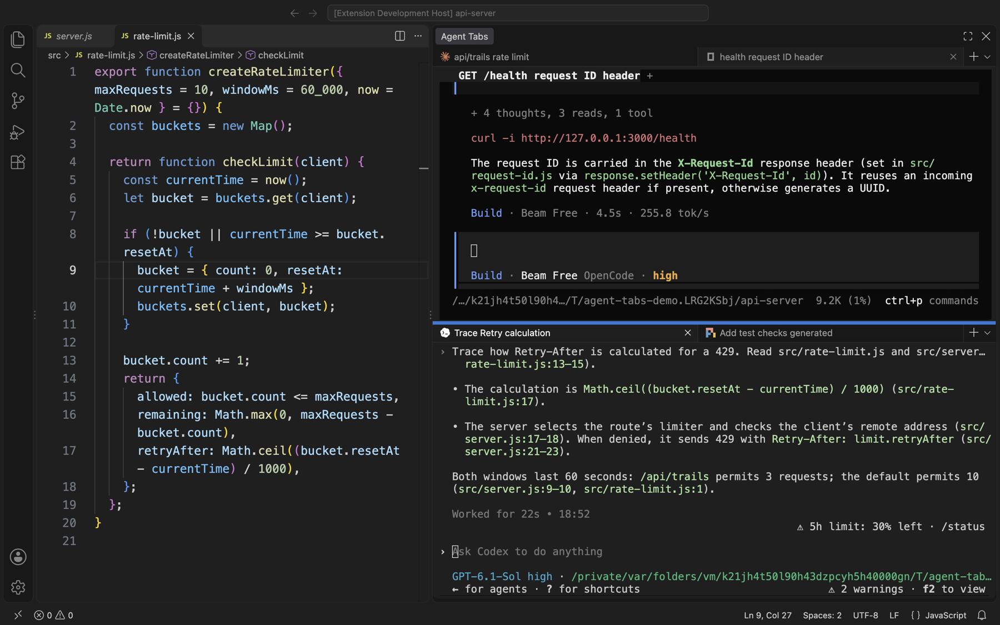
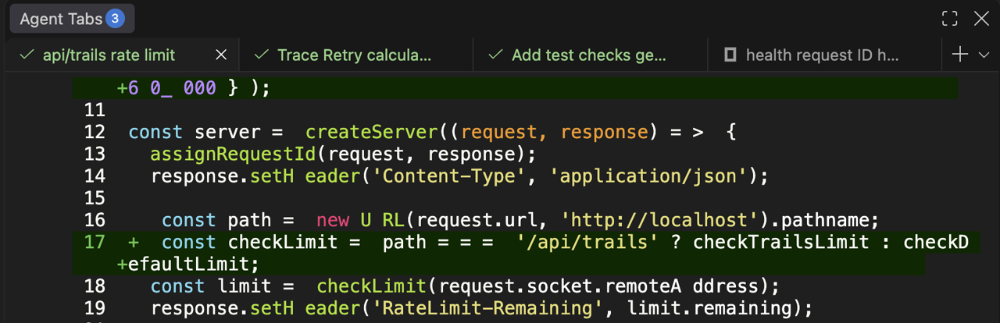
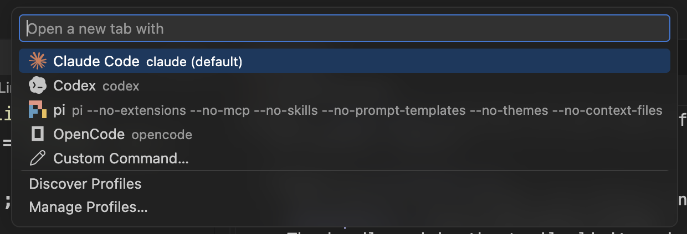

# Agent Tabs

Agent Tabs runs terminal coding agents in VS Code’s secondary sidebar. Drag a chat into a split pane, move tabs between panes, and see when an agent needs your input.

[](media/screenshots/demo.mp4?raw=true)

[Watch the 44-second demo](media/screenshots/demo.mp4?raw=true).

## Install

Install [Agent Tabs from the Visual Studio Marketplace](https://marketplace.visualstudio.com/items?itemName=patrick-lindemann.agent-tabs), or run:

```bash
code --install-extension patrick-lindemann.agent-tabs
```

You need VS Code 1.106 or later and an agent on your `PATH`. Open **Agent Tabs** in the secondary sidebar. Click `+` to start the default profile, or use the arrow next to it to pick another one.

For an offline or remote machine, get the `.vsix` for your platform from the [latest release](https://github.com/patrick-lindemann/agent-tabs/releases/latest). Use **Extensions: Install from VSIX…**, or run:

```bash
curl -fsSL https://raw.githubusercontent.com/patrick-lindemann/agent-tabs/main/install.sh | sh
```

## Split and move tabs



Drag a tab onto the top or bottom half of a terminal to stack the panes. Drop it near the left or right edge to put them side by side. You can split a pane again in either direction.

Drag a tab along its strip to reorder it. Drop it on another pane’s strip to move it there. To resize the panes, drag the divider. New tabs and tab shortcuts use the last pane you focused.

Right-click a sidebar tab and select **Move to Editor Area**. To return it, right-click the editor tab and select **Move to Sidebar**, or close the editor. The agent keeps running while you move its tab.

Tabs shrink together, then scroll sideways when they reach their minimum width. The `+` and profile buttons follow the tabs and stay visible when the strip scrolls.

## Tab names and status



A new tab takes its name from your first message until the agent names the session. The tab shows whether the agent is working, needs input, finished, or failed. The sidebar badge counts tabs that are waiting for you. A background result stays marked until you visit its tab.

Right-click a tab and select **Rename…**. In the sidebar, edit the label directly. In the editor area, VS Code opens a name field. Press Enter to save or Escape to cancel.

Renaming changes the conversation name where the agent supports it: Claude Code, Codex, Cursor, OpenCode and Antigravity with `/rename`, pi with `/name`, Gemini CLI with `/chat rename`. The name stays with the conversation, so it survives a reopened tab and the agent keeps reporting it. Terminals and agents without such a command get a tab name that lasts while the tab is open.

Some agents report their status over the [Program Status Protocol](https://www.superlogical.com/rex/docs/build/program-status). For other agents, Agent Tabs detects prompts. A pi tab can also show the status of [background subagents](docs/pi-subagents.md).

Click a file reference such as `src/app.ts:42` in an answer to open that line in the editor. The terminal uses VS Code’s theme and font. Agent Tabs asks before closing a busy tab. If an agent exits and the tab stays open, press Enter to start it again.

## Agent profiles



Agent Tabs creates profiles for the agents it finds. A profile runs a command line, so you can use `claude --continue`, `env MODEL=fast pi`, or your own wrapper. The **Terminal** profile opens VS Code’s default shell. **Custom Command…** runs a one-off command and can suggest flags. If you’ve set up your own profiles, use **Discover Profiles** in the picker or Command Palette to add agents you installed later.

## Save and reopen sessions

Agent Tabs restores the panes, tab order and active tab when you reopen a workspace. Claude Code, pi and Cursor resume conversations that have a message. Other agents start their profile again in the same folder. **Reopen Closed Tab** can also resume a conversation in those three agents.

Use [tmux or abduco](docs/sessions.md) if you want agents to keep running after you close VS Code or lose a remote connection. Closing the tab itself ends the session.

## Supported agents

| Agent | Command | Status | Tab name from |
| --- | --- | --- | --- |
| Claude Code | `claude` | Reported (2.1.295+) | Conversation summary |
| Codex | `codex` | Reported (0.163+) | Thread name |
| pi | `pi` | Reported (1.1+) | Session name (`/name`) |
| OpenCode | `opencode` | Reported | Session title |
| Grok Build | `grok` | Reported (1.0.52+) | — |
| Devin | `devin` | Reported | — |
| Hermes Agent | `hermes` | Reported | Session title |
| Gemini CLI | `gemini` | From prompts | Current thought |
| GitHub Copilot | `copilot` | From prompts | — |
| Cursor | `agent` | From prompts | — |
| Antigravity | `agy` | From prompts | Your title script |

Agent Tabs recognizes an agent behind `env`, `nohup`, `npx`/`bunx`/`pnpm dlx`, `tmux new-session`, `abduco`, `ssh <host>` or `bash -c`. It matches package runners by command or package name. It does not check the local `PATH` for an agent that runs through `ssh` or from a package. It leaves arguments alone when you run a subcommand such as `claude doctor`.

You can run other programs too. Shells get the terminal icon. Other programs get a sparkle and use prompt detection for status. Set a profile’s `kind` to override its icon, for example `"kind": "claude"` for a script that launches Claude Code or `"kind": "sparkle"` for a generic icon. Use `null` or omit `kind` to infer it from the command. Use `agentTabs.multiplexer` instead of wrapping the command in `tmux`, which hides status reports.

## Keyboard shortcuts

These shortcuts apply when Agent Tabs has focus. On Windows and Linux, `Ctrl+W` still deletes a word in the terminal.

| Action | macOS | Windows / Linux |
| --- | --- | --- |
| New tab | `Cmd+N` | `Ctrl+N` |
| Close tab | `Cmd+W` | `Ctrl+Shift+W`, `Ctrl+F4` (Windows) |
| Reopen closed tab | `Cmd+Shift+T` | `Ctrl+Shift+T` |
| Next / previous tab | `Cmd+Alt+→` / `Cmd+Alt+←`, `Cmd+Shift+]` / `Cmd+Shift+[` | `Ctrl+PageDown` / `Ctrl+PageUp` |
| Go to tab 1–9 / last tab | `Ctrl+1` … `Ctrl+9` / `Ctrl+0`, `Cmd+9` | `Alt+1` … `Alt+9` / `Alt+0` |
| Recently used tabs | `Ctrl+Tab` / `Ctrl+Shift+Tab` | `Ctrl+Tab` / `Ctrl+Shift+Tab` |
| Move tab left / right | `Cmd+K` `Cmd+Shift+←` / `Cmd+K` `Cmd+Shift+→` | `Ctrl+Shift+PageUp` / `Ctrl+Shift+PageDown` |
| Split into a new pane below | `Cmd+\`, `Ctrl+Shift+5` | `Ctrl+Shift+5` |
| Split into a new pane to the right | `Cmd+K` `Cmd+\` | — |
| Focus previous / next pane | `Cmd+Alt+↑` / `Cmd+Alt+↓` | `Alt+↑` / `Alt+↓` |

Split shortcuts open a new tab in the new pane. When the view is split, tab shortcuts and **Close Others** apply to the focused pane. You can bind **Move Tab to Start** and **Move Tab to End** in Keyboard Shortcuts.

`Cmd+←/→` goes to the start or end of a line. `Cmd+Backspace` deletes to the start of the line, and `Option+Backspace` deletes the previous word. `Shift+Enter` inserts a new line in agents that support it.

## Settings

### Profiles and tabs

| Setting | Default | Description |
| --- | --- | --- |
| `agentTabs.profiles` | installed agents | Profiles in menu order. Each has a unique `name`, a `command` and optional `env` and `multiplexer`. Remote windows use the remote settings. |
| `agentTabs.defaultProfile` | first profile | The `name` of the profile `+` opens, e.g. `Claude Code`. |
| `agentTabs.multiplexer` | `none` | Run tabs in `tmux` (3.2+) or `abduco` sessions that outlive the window. |
| `agentTabs.onExit` | `auto` | `auto` closes the tab after a clean exit and keeps it after an error. Other choices: `close`, `restart`, `keep`. |
| `agentTabs.restoreTabs` | `true` | Restore tabs and panes. Claude Code, pi and Cursor can resume conversations. |
| `agentTabs.confirmClose` | `true` | Ask before closing a tab that is working, needs input, or still has a detached session. |

### Tab names and icons

| Setting | Default | Description |
| --- | --- | --- |
| `agentTabs.autoTabTitles` | `true` | Use the session title or first message instead of the profile name. |
| `agentTabs.tabTitleWords` | `4` | Maximum words in a tab name (1–12). Agent Tabs drops filler words. |
| `agentTabs.transformTabTitles` | `true` | Use sentence case for titles from the first message and Claude Code’s generated names. `fix-login-bug` becomes `Fix login bug`. |
| `agentTabs.monochromeIcons` | `false` | Use the text color for agent logos instead of brand colors. |

### Status

| Setting | Default | Description |
| --- | --- | --- |
| `agentTabs.programStatus` | `true` | Show the status agents report. |
| `agentTabs.statusColors` | `true` | Color status icons and the names of tabs that need you. |
| `agentTabs.promptNotification` | `true` | Mark background tabs when agents that do not report status show a prompt. |
| `agentTabs.promptNotificationDelay` | `300` | Milliseconds of quiet output before a prompt counts. |
| `agentTabs.promptPatterns` | `[]` | Additional regular expressions that match a prompt. |

### Process

| Setting | Default | Description |
| --- | --- | --- |
| `agentTabs.directMode` | `true` | Start the command directly. Turn off to use shell aliases or syntax. |
| `agentTabs.shell` | system shell | Shell to use when `directMode` is off. |
| `agentTabs.autoRun` | `true` | With `directMode` off, run the profile’s command when the shell starts. |
| `agentTabs.env` | `{}` | Environment variables for every tab. |

## Troubleshooting

- **Agent not found:** Start VS Code from a shell that can run the command, or add the agent’s directory to `PATH` through `agentTabs.env`.
- **Shell aliases or functions do not work:** Turn off `agentTabs.directMode`.
- **Blank terminal after a VS Code update:** Update Agent Tabs. Its terminal module must match your version of VS Code.

## Contributing

Report issues or open a pull request on [GitHub](https://github.com/patrick-lindemann/agent-tabs). See [CONTRIBUTING.md](CONTRIBUTING.md) for development and tests.

## Acknowledgements

Agent Tabs started as a fork of [Nolikzero/claude-terminal-panel](https://github.com/Nolikzero/claude-terminal-panel). It uses [xterm.js](https://xtermjs.org/), [node-pty](https://github.com/microsoft/node-pty), [stopword](https://github.com/fergiemcdowall/stopword), VS Code Codicons and Lobe Icons. See [THIRD_PARTY.md](THIRD_PARTY.md).

## License

[MIT](LICENSE.md)
